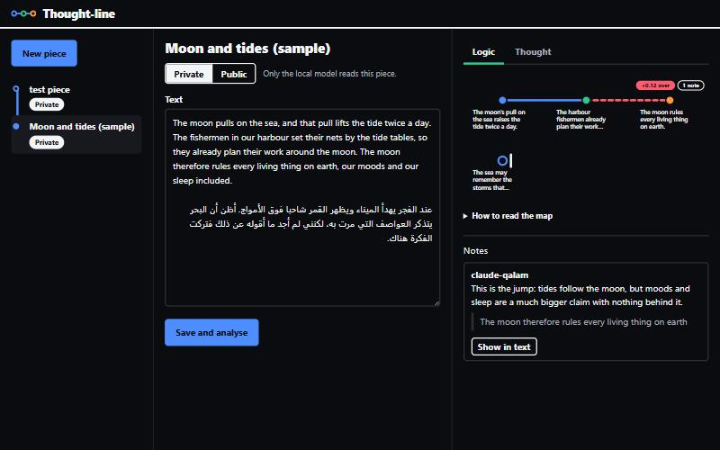

# Thought-line

Thought-line reads a piece of writing with a model that runs on your own machine and shows it as two maps. The **Logic** map draws the claims and what supports them as a transit map, and marks where a claim is stated more surely than its support allows. The **Thought** map follows the images and motifs through the piece, in the order they appear. AI agents can read the maps over MCP and leave margin notes on the passages they are about.

It is a local tool. You bring your own local model, served through an OpenAI-compatible endpoint such as LM Studio or llama.cpp. A cloud key is optional, and it is only ever used for pieces you have marked public.



Status: this is the first working version. The interface is being redesigned, and a desktop app for Windows and macOS is planned. A public bring-your-own-key version is planned too.

## Requirements

- Node 22 or newer.
- A local model behind an OpenAI-compatible server that supports structured output (`response_format` with a JSON schema). LM Studio and llama.cpp both do. A model that handles your writing language well matters more than size; see "Model" below.
- Optional: Tailscale, to reach the tool from your other machines.

## Install

```
git clone <this repository>
cd thought-line
npm install
npm run build
```

`npm run build` builds the web page the server serves. Run it again after pulling changes.

## Configure

Copy `.env.example` to `.env` and edit it. `.env` is gitignored; never commit it.

| Variable | What it does |
|---|---|
| `TL_TOKEN` | Required. The bearer token every `/api` and `/mcp` request must carry. At least 24 characters, no spaces. The placeholder from `.env.example` is refused. Make one with `node -e "console.log(require('crypto').randomBytes(32).toString('hex'))"`. |
| `TL_HOST` | The address to listen on. Default `127.0.0.1`. Use your Tailscale address to reach it from other machines. The server refuses to start if this is `0.0.0.0`, `::` or anything else that binds every interface. |
| `TL_PORT` | Default `4390`. |
| `TL_DATA_DIR` | Where pieces and analyses are stored, as plain files. Default `./data`. |
| `TL_MAX_CHARS` | The longest piece the tool will analyse, in characters. Default `24000`. A longer piece is refused with a message rather than cut. |
| `TL_LOCAL_BASE_URL` | The OpenAI-compatible endpoint of your local model, for example `http://127.0.0.1:1234/v1`. Private writing is sent here. |
| `TL_LOCAL_MODEL` | The model id to ask for. |
| `TL_LOCAL_ALLOW_HOST` | See the house rule below. Normally empty. |
| `TL_CLOUD_BASE_URL`, `TL_CLOUD_MODEL`, `TL_CLOUD_API_KEY` | Optional cloud model, used only for pieces marked public. Set all three or none. |
| `TL_FIXTURE_ANALYSIS` | Development only. A path to a canned analysis; the tool serves it instead of calling a model, so you can try the interface without one. |
| `TL_EVAL_MODELS` | Used by `npm run eval` only. Comma-separated model ids loaded on `TL_LOCAL_BASE_URL`. |

**The house rule.** `TL_LOCAL_BASE_URL` has to point at a machine in the house: this machine (`localhost`, `127.x.x.x`), a private LAN address (`10.x`, `172.16-31.x`, `192.168.x`), a Tailscale address (`100.64.0.0/10`) or a `*.local` name. Anything else is refused at startup, because private writing is sent to that endpoint. If your model really lives at another name, such as a Tailscale MagicDNS name like `box.tailnet.ts.net`, put exactly that hostname (no scheme, no port) in `TL_LOCAL_ALLOW_HOST` to say so on purpose.

## Run

```
npm start
```

Open `http://<TL_HOST>:<TL_PORT>` in a browser. The page asks for your token once and keeps it in that browser.

To use it from your other machines, run it on the machine that holds the model and the data, set `TL_HOST` to that machine's Tailscale address (find it with `tailscale ip -4`), and open `http://<that address>:4390` from anywhere on your tailnet. Nothing is exposed beyond it.

## Import your writing

Import a folder of `.md`, `.txt`, `.html` or `.docx` files:

```
npm run import -- "C:\path\to\writing"
npm run import -- "C:\path\to\site\writing" --public
npm run import -- "C:\path\to\writing" --analyze
```

- **Stop the server first.** The importer refuses to run while the server is up, because only one process may write the data.
- Pieces are **private by default**. Use `--public` for pieces that are already published, such as site posts; only public pieces can ever go to a cloud model.
- Importing alone does not call any model. Add `--analyze` to analyse each piece as it is imported.
- Importing the same folder again updates the text of pieces that changed but keeps their titles, and it **overwrites any edits you made to that text in the app**. Re-import only files you still edit on disk.
- The command prints counts and the names of files that failed, never the writing itself.

## Connect an agent

Any MCP client that speaks Streamable HTTP can connect. With Claude Code:

```
claude mcp add --transport http thought-line http://<tailscale-ip>:4390/mcp --header "Authorization: Bearer <token>"
```

For clients that only speak stdio, bridge with `mcp-remote`:

```
npx mcp-remote http://<host>:4390/mcp --header "Authorization: Bearer ${TL_TOKEN}"
```

with `TL_TOKEN` set in that client's environment.

A long analysis returns only when it has finished, and one analysis runs at a time. A client with a short request timeout may give up before the answer arrives; the server does not cancel the analysis when a client gives up, so read the result with `read_piece` afterwards.

The five tools:

- `list_pieces`: every piece, newest first, with its id, title, privacy and how many analysed versions it has.
- `read_piece`: one piece with its text, stations, links, motifs and margin notes, flattened into one object.
- `analyze_piece`: analyse the current text of an existing piece with the configured model and save a new version.
- `analyze_text`: file a draft of the agent's own as a new piece (private unless said otherwise), analyse it and return the result.
- `add_note`: leave a margin note on a quoted passage of a piece.

## Privacy

- A new piece is private. A private piece is only ever sent to the local model, and the code refuses to route it anywhere else.
- A public piece is sent to the cloud model if you configured one, and to the local model otherwise.
- The tool makes no other network calls: no telemetry, no analytics, no fonts or scripts from a CDN.
- Your pieces, analyses and evaluation results live in `data/` and `eval/`. Both are gitignored and stay on your machine, as does `.env`.
- Every `/api` and `/mcp` request needs the bearer token, and the server will not listen on all interfaces.

## Model

The default local model is chosen by running `npm run eval` on real pieces and marking the results by hand. The tally of marks goes here once it has been run:

| Model | Logic right | Thought right | Seconds per piece |
|---|---|---|---|
| | | | |

Chosen model: not yet chosen.

### How to run the evaluation

1. Load the candidate models in your local server and set `TL_EVAL_MODELS` to their ids.
2. List a handful of real pieces, a mix of personal writing and posts, in `eval/samples.local.json`:
   `[{ "path": "C:/writing/piece.md", "label": "essay-1" }]`. Labels become file names, so keep them short and distinct.
3. Run `npm run eval`. For every model and piece it writes `eval/out/<model>/<label>.json` and one marking sheet, `eval/out/REVIEW.md`, which lists the station count, jumps, dead ends, loops, the motif path and the time taken, with two boxes to tick: `Logic right?` and `Thought right?`.
4. Tick the boxes. The model with the most ticks becomes `TL_LOCAL_MODEL`; if two are tied, the faster one wins.

The evaluation only talks to `TL_LOCAL_BASE_URL`, never to a cloud model, and it prints progress, counts and paths, never your text. With `TL_FIXTURE_ANALYSIS` set it runs against the canned analysis instead, which is a quick way to check the script itself.

## First run

The steps for setting this up on the machine that will hold the model:

1. Install it (above), set `.env` with `TL_HOST` as that machine's Tailscale address and a fresh `TL_TOKEN`, and start your local model server.
2. Pick three candidate models that fit your GPU memory with room for a context of 8k tokens or more, with good structured output and good support for your writing language. Note why you picked each.
3. Choose five or six pieces, a mix of personal writing and posts, list them in `eval/samples.local.json` and run `npm run eval`.
4. Mark `eval/out/REVIEW.md`, set `TL_LOCAL_MODEL` to the winner and record the tally in "Model" above.
5. Stop the server if it is running, import your writing folder (private) and your site's writing folder (`--public`), then start it.
6. Connect your agents to `/mcp` on each machine, and check that `list_pieces` returns your pieces.

## Development

```
npm run dev:server   # the API and MCP server, restarting on change
npm run dev:web      # the web page, with hot reload
npm test
npm run typecheck
```

`src/core` is pure: it holds the analysis schema, the certainty rule, the structure and the prompt, and imports nothing from Node. A test enforces that.

## License

MIT. See `LICENSE`.
